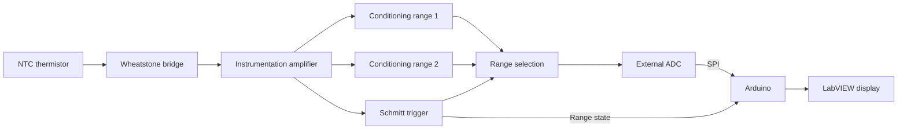

# NTC Temperature Measurement

**Analogue temperature measurement with an NTC thermistor, Arduino and LabVIEW.**

Our group developed this project for the Applied Electronics course at Instituto Superior de Engenharia do Porto (ISEP). The aim was to measure temperature for a possible wine-storage application, using analogue circuits for most of the signal processing.

The prototype combined a Wheatstone bridge, an instrumentation amplifier, two signal-conditioning ranges and a Schmitt trigger. An external ADC sent readings to an Arduino, and a LabVIEW interface displayed temperature and the selected range.

## What the group developed

- A measurement circuit using a 33 kΩ NTC thermistor.
- A Wheatstone bridge and instrumentation amplifier to convert resistance changes into voltage.
- Two analogue conditioning ranges, with a nominal changeover near 15 °C.
- A Schmitt trigger to select the range with hysteresis.
- ADC acquisition through Arduino and a LabVIEW display.
- Circuit simulations, tolerance studies and bench measurements.

The design covered a nominal range of **0 to 40 °C**. A temperature-controlled chamber and heating or cooling actuators were possible future applications; they were not part of the demonstrated prototype.

## Signal path

## Prototype evidence

The report includes simulations and measurements of the individual stages, followed by a demonstration of the assembled circuit. For the final range checks, a variable resistor represented the NTC response because a controlled-temperature chamber was not available. These checks do not establish calibrated temperature accuracy across the full range.

[Read the results and limitations](docs/RESULTS.md).

## Files

| Folder | Contents |
| --- | --- |
| [hardware/](hardware/README.md) | Original schematic images and short circuit notes |
| [docs/](docs/DESIGN.md) | Design summary, results and information about the recovered material |
| [images/](docs/SOURCES.md) | Original block diagram, simulation plots and prototype photographs |

## Available material

[Read the original report (Portuguese, PDF)](docs/report/NTC-Temperature-Measurement-report.pdf).

This is a documentation repository recovered from the group's original report. The Arduino source, LabVIEW project and editable circuit and simulation files are no longer available. The images show the original work; they have not been redrawn or presented as new measurements.

See [material sources and figure references](docs/SOURCES.md) for the report page associated with each image.

## Academic context

The project was developed jointly by a student group at ISEP. This repository presents the group's work and does not assign individual contributions. It is maintained by Filipe Fonseca.

The prototype was an academic exercise.
