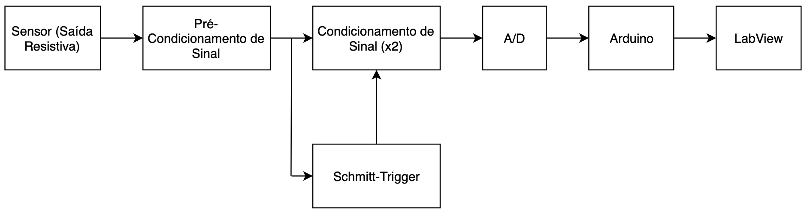

# Design summary

## Intended application

The group investigated temperature measurement for a possible wine-storage system. The work demonstrated the measurement chain and its display. Automatic regulation through heating or cooling actuators was described as a possible next step.

## Sensor and measurement range

The selected sensor was a Vishay NTCLE100E3333JB0, with a nominal resistance of 33 kΩ at 25 °C. The report uses the following resistance values for the design:

| Temperature | NTC resistance used in the report |
| --- | --- |
| 0 °C | 109.4 kΩ |
| 15 °C | 52.24 kΩ |
| 25 °C | 33 kΩ |
| 40 °C | 17.34 kΩ |

These are design values, not a calibration table obtained from the assembled prototype. The report records the use of a sensor with 3% nominal-resistance tolerance.

## Original block diagram

*Report: Figure 1, page 1.*

The project used analogue electronics for the bridge, amplification, conditioning and range selection. The Arduino interpreted the converted signal and the selected range, while LabVIEW provided the user interface.

## Circuit stages

| Stage | Purpose | Main design choice |
| --- | --- | --- |
| NTC | Sense temperature through resistance changes | 33 kΩ nominal resistance to limit current |
| Wheatstone bridge | Convert resistance changes into a voltage difference | Balance near the high-temperature end of the intended range |
| Instrumentation amplifier | Read and amplify the bridge difference | High input impedance and intended gain near 1.2 |
| Conditioning circuits | Scale two sections of the nonlinear response | Separate gains and a reference offset |
| Schmitt trigger | Select the active range | Hysteresis around the nominal 15 °C changeover |
| Multiplexer and ADC | Select and digitise the signal | External ADC with SPI communication |
| Arduino and LabVIEW | Interpret and display measurements | Conversion dependent on the selected range |

The report provides component calculations and describes practical adjustments with trimmer resistors. This repository keeps a short explanation of those decisions rather than reproducing all calculations.

## Simulations and bench work

The group used transient analysis, DC sweeps and Monte Carlo simulations to study individual stages. Bench work then compared expected voltages with the constructed circuits. The final demonstration used a variable resistor to represent the NTC over its intended range.

The report contains some differences between calculated values, schematic labels and measured outputs. The recovered figures preserve those details. They should be read as a record of the academic work, not as a newly validated design.

[Original schematics](../hardware/README.md) · [Recorded results](RESULTS.md)
