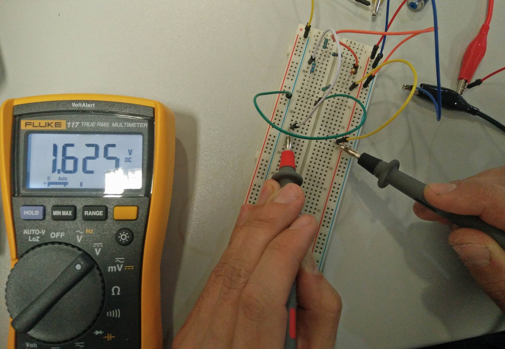
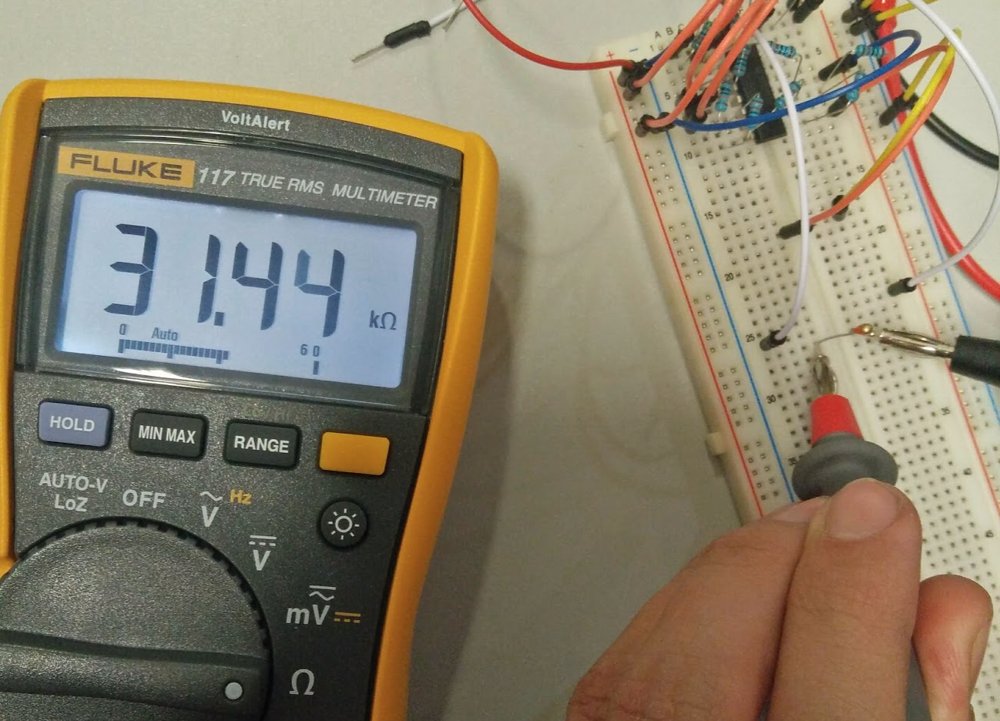
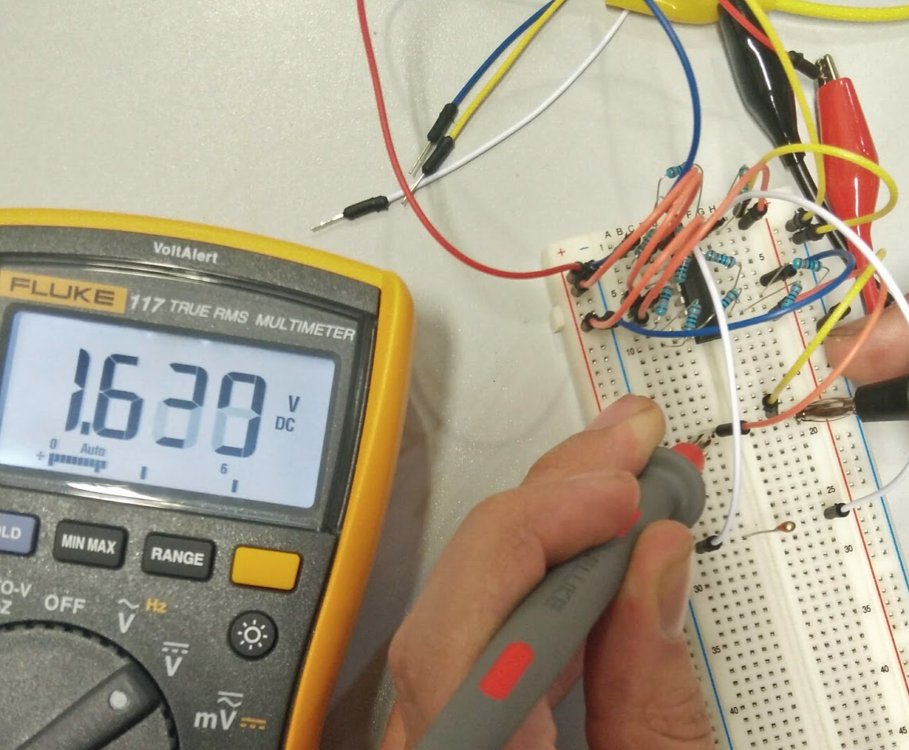
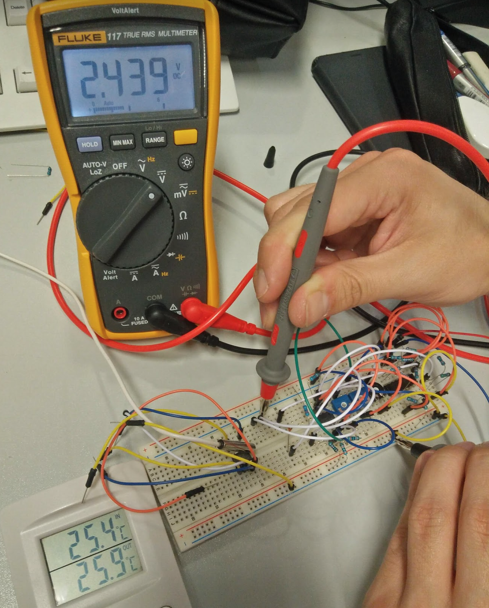
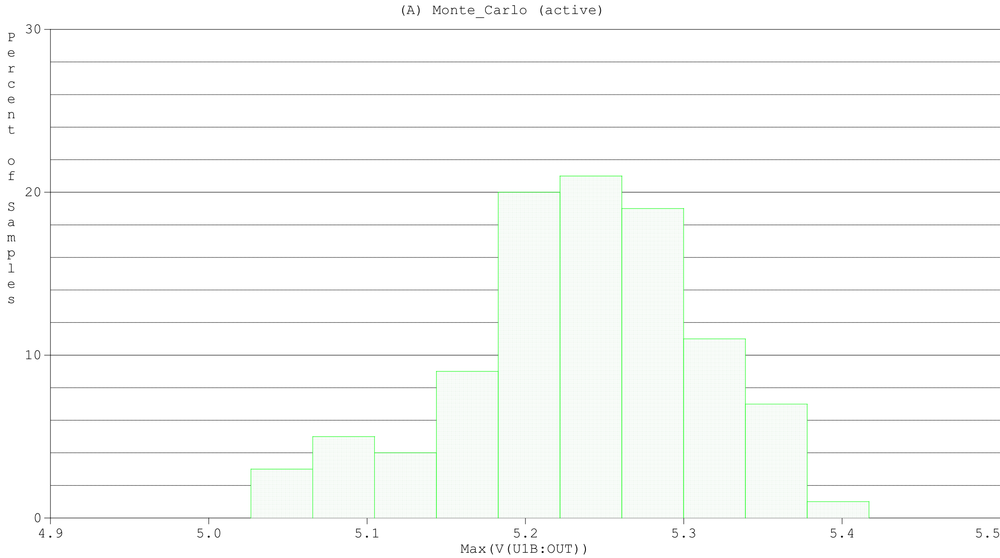
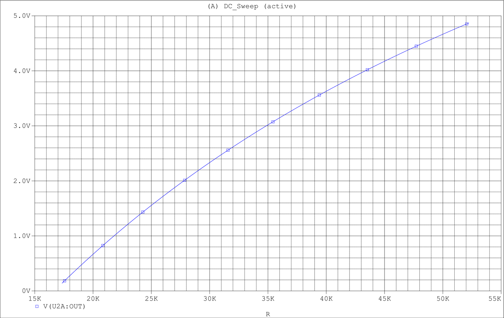
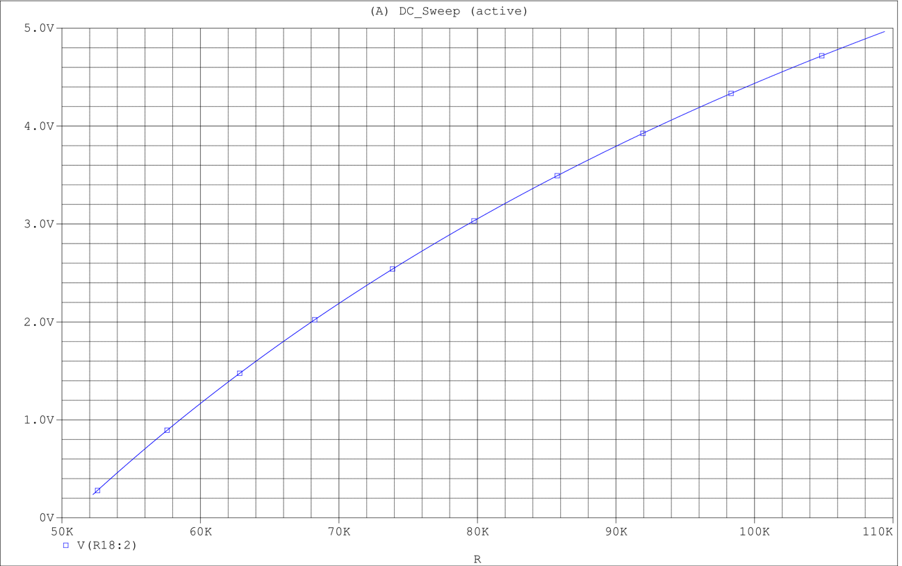
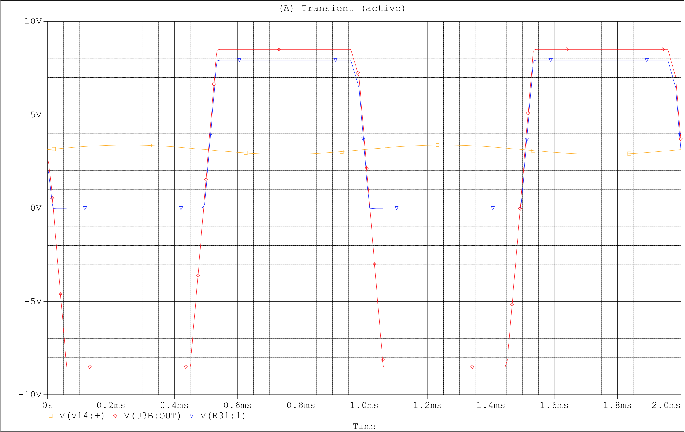
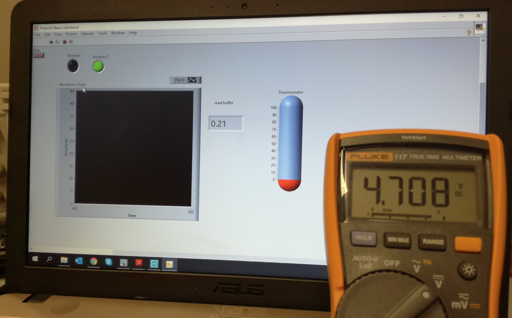
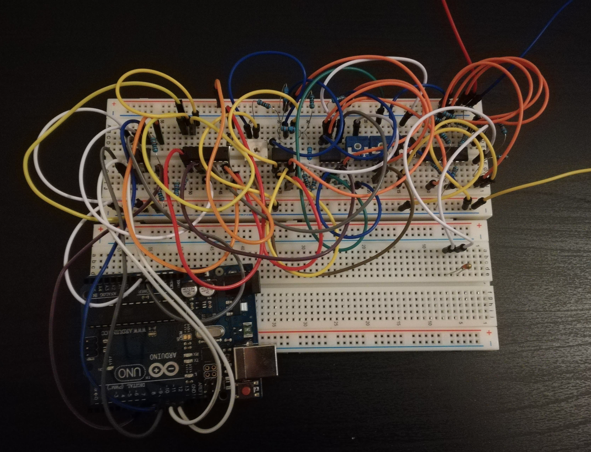

# Results and limitations

The evidence below comes from the group's original report. No new measurements or simulations have been performed for this repository.

## Bench observations

### Wheatstone bridge

*Report: Figure 7, page 6.*

The group measured the bridge response and used a variable resistor to represent sensor resistances that could not be set precisely by controlling the actual temperature.

### Instrumentation amplifier and sensor

| NTC resistance measurement | Preconditioning output measurement |
| --- | --- |
|  |  |

*Report: Figure 9, page 7.*

The report records a small offset in the instrumentation amplifier and qualitative checks in which heating the sensor changed the output in the expected direction. It does not provide a complete measured temperature-error curve.

### First conditioning stage

*Report: Figure 10, page 7.*

The report gives a measured output of **2.439 V**, compared with an expected value slightly below **2.754 V** for that test. It states that a mathematical correction was applied in the Arduino program. The program is no longer available, so the implementation of that correction cannot be inspected here.

## Simulation evidence

### Preconditioning tolerance study

*Report: Figure 8, page 7.*

This simulation considered the maximum NTC resistance used in the design and 1% resistor tolerances. It illustrates the simulated spread in the circuit response; it is not a measured temperature-accuracy result.

### Conditioning ranges

*Report: Appendix 3, Figure 3, page 11.*

*Report: Appendix 3, Figure 5, page 12.*

The DC sweeps show the simulated response of the two conditioning stages. The original simulation projects are no longer available.

### Schmitt trigger

*Report: Figure 11, page 7.*

The report describes an input varying around the switching point, the comparator output and the output after the diode. This shows the intended switching behaviour in simulation.

## Final demonstration

*Report: Figure 12, page 8.*

*Report: Figure 13, page 8.*

The final prototype combined the analogue circuits, ADC, Arduino and LabVIEW interface. A variable resistor represented the NTC resistance over the intended range for the final checks.

## Practical limits

- The complete system was not characterised in a controlled-temperature chamber.
- Tests using a variable resistor checked the circuit response, not the sensor's thermal behaviour or complete temperature accuracy.
- Sensor and resistor tolerances, amplifier offset and loading effects contributed to differences between calculations and measurements.
- Breadboard connections were identified as a source of instability.
- The original code and editable simulation files are unavailable, so the documented conversion and correction steps cannot be reproduced directly from this repository.

The work supports a demonstration of analogue measurement and acquisition. It does not establish a calibrated thermometer or a complete wine-storage temperature controller.
