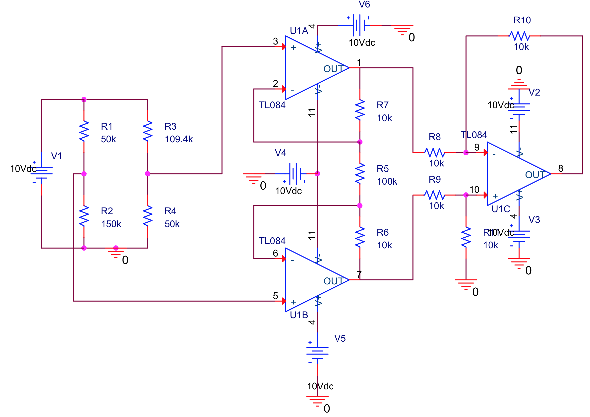
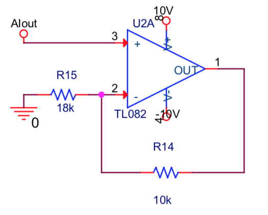
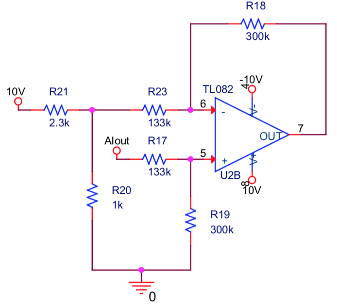
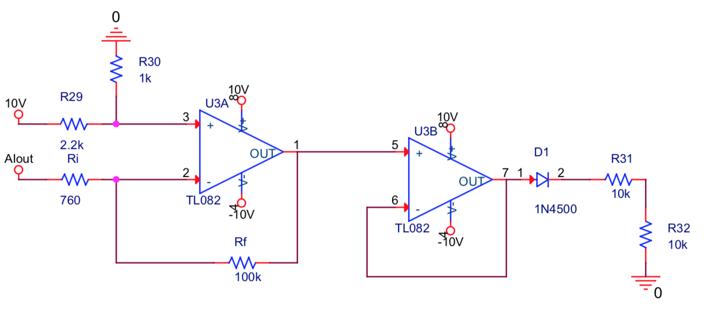

# Hardware

The group designed the analogue stages to convert the NTC resistance into a voltage suitable for acquisition. The images below were recovered from the original report. Component values and connections have not been changed.

## Wheatstone bridge and instrumentation amplifier

*Report: Figure 2, page 1; circuit discussion on pages 2 and 3.*

- A 33 kΩ NTC forms one arm of the bridge. Its resistance decreases as temperature rises.
- The bridge was designed around the intended 0 to 40 °C range. High resistance values were chosen to limit current and reduce sensor self-heating.
- The report gives 144 kΩ as the calculated bridge resistor value and records the use of 150 kΩ in the build.
- The instrumentation amplifier provides high input impedance and amplifies the bridge difference. The intended gain was approximately 1.2.
- The report records a change from two TL082 packages to one TL084 during construction.

The report's calculated instrumentation-amplifier output reaches approximately 5.24 V. The ADC was operated with a 5 V supply, so the signal levels would need to be checked before rebuilding the system. The document is not a complete wiring or protection guide.

## First conditioning range

*Report: Figure 5, left circuit, page 4.*

This non-inverting stage was designed for the lower instrumentation-amplifier output range, corresponding approximately to 15 to 40 °C. Its intended gain was about 1.55, to use more of the ADC input range.

## Second conditioning range

*Report: Figure 5, right circuit, page 4.*

This differential stage was designed for the higher input range, corresponding approximately to 0 to 15 °C. It uses a reference near 3.03 V and an intended gain of about 2.27. Trimmer resistors were used to adjust the practical circuit.

The two ranges approximate the nonlinear NTC response over separate intervals. Their use does not by itself establish temperature accuracy.

## Range selection with a Schmitt trigger

*Report: Figure 6, page 5.*

The Schmitt trigger selects the conditioning range. The nominal switching point was near 3.13 V at the instrumentation-amplifier output, corresponding to about 15 °C. Hysteresis was intended to prevent repeated switching around the changeover point.

The report describes a diode, a voltage divider and a buffer for adapting the switching signal. The range state was also read by the Arduino so that the appropriate temperature-conversion equation could be selected.

## Acquisition and display

The report identifies the MCP3002 as the external 10-bit ADC and describes SPI communication with the Arduino. A separate multiplexer selected the conditioned signal. The available figures do not provide a complete connection diagram for the multiplexer, ADC and Arduino.

LabVIEW displayed the processed temperature, a time plot and indicators for the active range.

[Design overview](../docs/DESIGN.md) · [Results and limitations](../docs/RESULTS.md)
